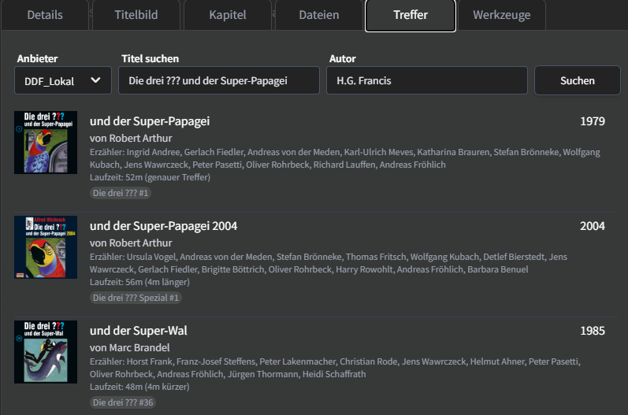
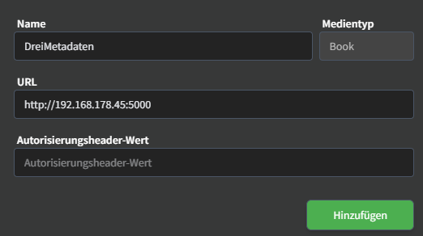

# Audiobookshelf DreiMetadaten Provider

Ein spezialisierter Metadata-Provider für Audiobookshelf, der deutsche Hörspiele aus der [dreimetadaten.de](https://dreimetadaten.de) Datenbank durchsuchbar macht.



## Unterstützte Serien
- **Die drei ???** (Hauptserie)
- **Die drei ??? Kids** 
- **DiE DR3i**
- **Die drei ??? Spezial**
- **Die drei ??? Kurzgeschichten**

## Features
- **Intelligente Suche**: Findet Titel auch bei Teilangaben ("Super-Papagei" findet "und der Super-Papagei")
- **Präzise Metadaten**: Korrekte Laufzeiten, Sprecher, Cover und Beschreibungen
- **Saubere Tags**: Minimalistische Tags wie bei Audible
- **Folgen-Nummer Suche**: Direkte Suche nach Folgen-Nummer (z.B. "6", "Folge 006", "Kids 6")
- **Ordnernamen**: Versteht typische Benennungen wie "Die drei ??? - 006 - und der sprechende Totenkopf"
- **Autor-unabhängig**: Suche funktioniert unabhängig von Autor-Angaben
- **Fuzzy Search**: Toleriert Tippfehler und findet ähnliche Titel
- **Korrekte Laufzeit**: Gesamtdauer auch bei mehrteiligen Folgen mit mehreren CDs

## Installation

Benötigt Python 3.9 oder neuer.

### Dependencies installieren
```bash
pip install -r requirements.txt
```

### Provider starten
```bash
python abs_dreimetadata.py
```

Der Provider läuft dann auf `http://localhost:5000` (mit dem Produktions-Server [waitress](https://docs.pylonsproject.org/projects/waitress/)).

### Einstellungen (Umgebungsvariablen, optional)

| Variable | Standard | Beschreibung |
|---|---|---|
| `PORT` | `5000` | Port des Providers |
| `HOST` | `0.0.0.0` | Netzwerk-Interface |
| `API_KEY` | – | Wenn gesetzt, muss Audiobookshelf diesen Wert als Authorization Header mitschicken |
| `CACHE_TTL` | `3600` | Sekunden, bis auf neue Daten geprüft wird |
| `LOG_LEVEL` | `INFO` | `DEBUG` zeigt zusätzlich die Bewertung der besten Treffer |

Beispiel: `API_KEY=geheim PORT=5050 python abs_dreimetadata.py`

## Docker

Der Provider kann auch als Docker-Container laufen. Das Image wird dabei direkt aus diesem Repository gebaut.

### Docker Compose (empfohlen)

Ohne das Repository zu klonen – einfach diese `docker-compose.yml` anlegen:

```yaml
services:
  dreimetadaten-provider:
    build: https://github.com/eisregner/audiobookshelf-dreimetadaten-provider.git#main
    container_name: dreimetadaten-provider
    ports:
      - "5000:5000"
    environment:
      - TZ=Europe/Berlin
      # Optional: Schlüssel, den Audiobookshelf als "Authorization Header Value" mitschicken muss
      # - API_KEY=geheim
    restart: unless-stopped
```

```bash
docker compose up -d
```

Updates einspielen: `docker compose build --pull && docker compose up -d`

Alternativ das Repository klonen und die mitgelieferte `docker-compose.yml` verwenden:

```bash
git clone https://github.com/eisregner/audiobookshelf-dreimetadaten-provider.git
cd audiobookshelf-dreimetadaten-provider
docker compose up -d
```

### Docker ohne Compose

```bash
docker build -t dreimetadaten-provider https://github.com/eisregner/audiobookshelf-dreimetadaten-provider.git#main
docker run -d --name dreimetadaten-provider -p 5000:5000 --restart unless-stopped dreimetadaten-provider
```

### Zusammen mit Audiobookshelf in einer Compose-Datei

Laufen beide Container in derselben `docker-compose.yml`, erreicht Audiobookshelf den Provider über den Service-Namen. Der Port muss dann nicht nach außen freigegeben werden:

```yaml
services:
  audiobookshelf:
    image: ghcr.io/advplyr/audiobookshelf:latest
    # ... deine bestehende Konfiguration

  dreimetadaten-provider:
    build: https://github.com/eisregner/audiobookshelf-dreimetadaten-provider.git#main
    restart: unless-stopped
```

In Audiobookshelf dann als URL `http://dreimetadaten-provider:5000` eintragen.

Der Container läuft als unprivilegierter Benutzer und hat einen eingebauten Health Check (`docker ps` zeigt `healthy`).

## Konfiguration in Audiobookshelf

1. Gehe zu **Einstellungen → Metadaten → Benutzerdefinierte Metadatenanbieter → Hinzufügen**
2. Füge einen neuen **Custom Metadata Provider** hinzu:
   - **Name**: DreiMetadaten Provider
   - **URL**: `http://localhost:5000` (oder deine Server-IP:5000)
   - **Authorization Header Value**: nur wenn `API_KEY` gesetzt ist, sonst leer lassen
3. Speichern und testen

## Beispiel-Suchen
```
"Die drei ??? und der Super-Papagei"  → Findet Folge 1
"Super-Papagei"                       → Findet Folge 1
"6"                                   → Findet Folge 6
"Folge 006"                           → Findet Folge 6
"Kids 6"                              → Findet Die drei ??? Kids Folge 6
"Die drei ??? - 125 - Feuermond"      → Findet Folge 125
"sprechende Totenkopf"               → Findet passende Folgen
"Eisenmann"                          → Findet "und der Eisenmann"
```

## Test

Nach dem Start einfach ein zweites Terminal öffnen um die Suche zu testen:

```bash
# Test-Suche
curl "http://localhost:5000/search?query=Super-Papagei"

# Health Check (zeigt Datenversion und Zeitpunkt des letzten Ladens)
curl "http://localhost:5000/health"
```

### Automatische Tests
```bash
pip install -r requirements-dev.txt
python -m pytest
```

## Troubleshooting

### Provider wird nicht gefunden
- Stelle sicher dass der Provider auf Port 5000 läuft
- Prüfe die URL in Audiobookshelf (IP-Adresse verwenden statt localhost bei separaten Servern)
- Checke Firewall-Einstellungen

### Keine Suchergebnisse
- Teste mit einfachen Queries wie "1" oder "Papagei"
- Logs checken: Der Provider gibt Debug-Informationen in der Konsole aus

## Technische Details

- **Framework**: Flask
- **Datenquelle**: [dreimetadaten.de GitHub API](https://github.com/YourMJK/dreimetadaten)
- **Caching**: Daten werden im Speicher gehalten und stündlich per ETag auf Änderungen geprüft; ist GitHub nicht erreichbar, werden die zuletzt geladenen Daten weiter genutzt
- **Fuzzy Search**: Toleriert Tippfehler und Teilangaben
- **Score-basiertes Ranking**: Beste Treffer zuerst
- **Metadaten**: Cover, Laufzeit (in Minuten), Sprecher (Hauptsprecher zuerst), Beschreibungen, Serie mit Folgennummer
- **Keine ASIN**: dreimetadaten.de enthält nur die Amazon-ID der CD, nicht die Audible-ASIN – eine falsche ASIN würde z.B. den Kapitel-Abgleich in Audiobookshelf stören

## API Endpoints

- `GET /search?query=<title>` - Suche nach Hörspielen
- `GET /detail?id=<id>` - Details zu einem spezifischen Hörspiel
- `GET /health` - Health Check
- `GET /name` - Provider Name
- `GET /version` - Version

## Ähnliche Projekte

- [**abs-agg**](https://github.com/Vito0912/abs-agg) von [Vito0912](https://github.com/Vito0912): Ein Metadaten-Provider, der viele Quellen in einem Server bündelt (u.a. Die drei ???, BookBeat, Storytel, ARD Audiothek, Goodreads) und als Docker-Image bereitsteht. Gut geeignet, wenn neben *Die drei ???* noch andere Hörbücher und Hörspiele abgeglichen werden sollen. Dieses Projekt ist dagegen ganz auf *Die drei ???* spezialisiert.

## Credits

- Metadaten von [dreimetadaten.de](https://dreimetadaten.de) by [YourMJK](https://github.com/YourMJK)
- Für [Audiobookshelf](https://www.audiobookshelf.org) by [advplyr](https://github.com/advplyr)
